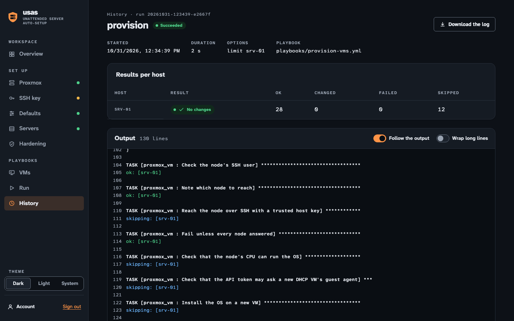
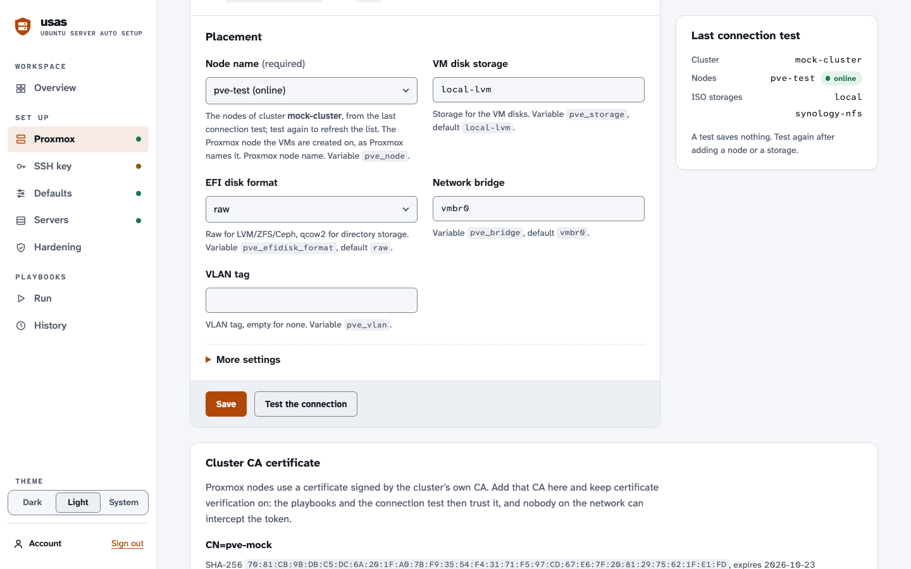

# The web UI and the container image

The container image `honeybeartech/ubuntu-server-auto-setup` on Docker Hub (mirrored to `ghcr.io/honeybeartech/ubuntu-server-auto-setup`) holds everything the playbooks need
(ansible-core, the collections, the playbooks and roles) plus a web UI, **USAS**, that lays out the options
as forms and runs the playbooks for you. It is the easiest way to use the project on Windows, and works the
same on Linux and macOS: you need only Docker.

The UI writes an ordinary Ansible inventory and an Ansible Vault file, the same ones the command line uses,
and runs `ansible-playbook` with them. Everything the playbooks do, and every warning in the
[README](../README.md), applies unchanged: **provisioning creates VMs and the installer wipes their disks;
the baseline changes SSH and firewall settings and can lock you out.**

## Starting it

The UI holds a Proxmox API token and a root SSH key, so it listens on `127.0.0.1` only. Read
[exposing it](#exposing-it-beyond-localhost) before you change that.

The image is published with each release from the first one that includes the web UI. Before that, or to
run your own changes, build it from a checkout: `docker compose up -d --build`, or
`docker build -t honeybeartech/ubuntu-server-auto-setup .` before the commands below.

**Windows** (Docker Desktop with the WSL 2 backend): download [`start.ps1`](../start.ps1) and run it in
PowerShell:

```powershell
powershell -ExecutionPolicy Bypass -File .\start.ps1
```

It starts Docker Desktop if needed, pulls the image, creates the container `usas` with its data in the
Docker volume `usas-data`, waits until it is healthy, puts the first-run setup code on the clipboard and
opens <http://localhost:8080>. Later runs just start it again. `-Update` pulls the latest image and
recreates the container (the data stays in the volume), `-Verify` checks the image's signature with
cosign first, `-Stop` stops it, and `-Port 8081` uses another port.

**Docker** (any system):

```sh
docker run -d --name usas --restart unless-stopped -p 127.0.0.1:8080:8080 -v usas-data:/data \
  honeybeartech/ubuntu-server-auto-setup
docker logs usas    # shows the setup code on the first start
```

**Docker Compose**: [`docker-compose.yml`](../docker-compose.yml) runs the same image with a read-only root
file system, no Linux capabilities and `no-new-privileges`: `docker compose up -d`, then
`docker compose logs usas` for the setup code. `docker compose up -d --build` builds the image from a
checkout instead.

Then open <http://localhost:8080>.

### The first sign-in

The first time, the UI asks for the **setup code** from the container's log and a **password** of at least
12 characters. The code proves that whoever sets the password also started the container: without it,
anyone (or any web page, through DNS rebinding) who reached the port first could choose the password. A new
code is printed every time the container starts until a password is set.

Forgot the password? Delete the password file and restart; the next start prints a new setup code. Your
settings, the Vault and the SSH key stay as they are:

```sh
docker exec usas rm /data/auth.json && docker restart usas && docker logs usas
```

Sessions end after 2 hours without activity, after 12 hours in any case, when you sign out, and when the
container restarts.

### Passkeys

Once signed in with the password, you can add **passkeys** on the account page (**Account** in the
sidebar): a passkey signs you in with your device's screen lock, a password manager or a security key
instead of the password. Name it (such as the laptop or password manager it is in), enter the current
password, and confirm on the device. The page lists your passkeys with when each was added and last used,
and removes them; removing one also signs out the sessions that signed in with it. On the sign-in page,
**Sign in with a passkey** sits next to the password form.

The password keeps working unless you turn on **Require a passkey** on the account page, which needs at
least one passkey. Then the sign-in page offers only passkeys, the password is refused without being
checked, and sessions that signed in with the password are signed out. Changing the password still works.

Every passkey must verify you (a PIN, a fingerprint or a face, not just a touch), and the UI keeps only each
passkey's public key, in `passkeys.json` in the data volume.

**Lost every passkey?** Delete the passkeys file; the password works again at once, no restart needed. Your
settings, the Vault and the SSH key stay as they are:

```sh
docker exec usas rm /data/passkeys.json
```

If you have forgotten the password too, also delete `auth.json` and restart, as above.

**Where passkeys work.** Browsers offer passkeys only on a secure page, and a passkey belongs to one host
name:

- On the same machine, open the UI at `http://localhost:<port>` (as `start.ps1` and the commands above
  do). That works without any setting, on any port. At `http://127.0.0.1:<port>` the page explains that
  passkeys belong to `localhost` and doesn't offer them: they aren't valid for an IP address.
- From another machine, the UI needs HTTPS under a host name, and that name in `USAS_PUBLIC_URL`, such as
  `USAS_PUBLIC_URL=https://usas.example.lan` (with the port if it isn't 443). Passkeys are then made for
  `usas.example.lan` and accepted only from exactly that address; the name is added to the allowed host
  names. Passkeys made for `localhost` don't work there, and the other way round, so add new ones after
  you set it. The host name comes from this setting, never from the request.

On a plain-HTTP page other than localhost the passkey buttons are hidden and the page says why. To get
HTTPS, use one of the setups in [exposing it](#exposing-it-beyond-localhost): a reverse proxy with a
certificate from your own CA or a public one (Caddy, nginx, Traefik), or an SSH tunnel, which keeps the
address `http://localhost:<port>` and so needs no `USAS_PUBLIC_URL` at all.

## The interface



The UI opens in a **dark theme**. The theme switch at the bottom of the sidebar (on a phone: under **Menu**)
offers **Dark**, **Light** and **System**, which follows the light or dark setting of your browser or
operating system. The choice is kept for that browser in a cookie (`usas_theme`) and applied before the
page is drawn, so pages don't flash in the other theme.

The sidebar lists the pages in the order you need them and marks the set-up pages done or still to do.
Below 960 pixels wide it folds into a top bar with a **Menu** button; the UI works down to a 375-pixel
phone screen. Movement is kept to a minimum (a pulsing dot on a running run), and none at all when the
system asks for reduced motion.



The UI is an app in the browser and needs JavaScript; without it, each page says so. Every value it sends
is checked again on the server, which is the only place that decides what is saved.

## Walking through it

The overview lists the steps and whether each is done.

1. **Proxmox**: the API host and port, the token's user, name and secret, and whether to verify the API's
   TLS certificate (keep it on). **Test the connection** calls the API with what you typed, without
   saving the form, and lists the cluster's nodes with their status (and the cluster's name, if the token
   may read it). From then on the node the VMs are created on (the default node; a server can name another
   on the Servers page) is a dropdown of those nodes, such as `hephaestus (online)`; node names are
   case-sensitive, and a name that isn't in the cluster is refused.
   The **ISO storage** (under More settings) becomes a dropdown of the storages that allow ISO images
   in the same way, if the token may list storages; the playbooks find its folder on the node themselves.
   Test again to refresh the lists (they are kept in `webui.json`). Then the storage, the bridge and an
   optional VLAN tag. The token needs the privileges in
   [installing.md](installing.md#2-create-the-proxmox-api-token).

   Proxmox nodes use certificates from the cluster's own CA. Paste `/etc/pve/pve-root-ca.pem` from the
   node into **Cluster CA certificate**, or fetch it over SSH once the next step is done (as root only:
   another node user can't read `/etc/pve`). The UI then
   trusts that CA (with the usual public ones) for the connection test and every playbook run, so
   verification can stay on.
2. **SSH key**: the UI's own key pair. **Create a key** makes an Ed25519 key in the data volume; or upload
   one (OpenSSH or PEM; a key with a passphrase must be in PEM format, or have the passphrase removed). Add
   the public key to the authorized keys of the user the UI logs in to the nodes as, `/root/.ssh/authorized_keys`
   by default, on each Proxmox node (the page shows the command). To use a user without root's privileges
   instead, set up each node with `playbooks/prepare-node.yml` from a checkout, giving it this public key
   ([installing.md](installing.md#6-optional-a-node-user-other-than-root)), and set **Node SSH user** under
   More settings on the Proxmox page. The page then lists every node in use, the default node first, with the
   servers on it: for each, enter its SSH address, **scan** its host key, compare the fingerprints with what
   that node shows
   (`ssh-keygen -lf /etc/ssh/ssh_host_ed25519_key.pub` in the node's shell), and **trust** them. Only then
   will the UI and the playbooks connect, and only to those keys; the overview's step is done when every
   node in use has an address and a trusted key. **Test the SSH login** checks the whole path. A node no
   server uses any more keeps its address until you **remove** it.
3. **Defaults**: the GitHub user whose keys are installed (**Preview the keys** shows what GitHub returns,
   filtered exactly as the roles filter it), extra public keys, whether to authorize the UI's own key on the
   servers (on by default: the baseline logs in with it), the admin user and password, the time zone, the
   **Default OS** (`vm_os`: a dropdown of the releases the project's OS catalog supports, such as
   `Ubuntu 24.04 (noble) · until 2029-05-31`; a release drops out of it when its support ends), the
   gateway (needed for servers with a static address), prefix length, DNS servers and search domains, the
   installer's disk layout (the Ubuntu installer's; cloud images come with their own), and **disk encryption** (`vm_disk_encryption`, off by default) with its
   passphrase. Encryption needs **Secure Boot keys** (under Installation, More settings) and the `lvm`
   layout, and the page refuses to save it without them or without a passphrase. The passphrase goes to the
   Vault as `vault_disk_passphrase`, is never shown again (keep a copy: it is the recovery key at the VM's
   console), and applies to VMs created after it is saved; see
   [security.md](security.md#secure-boot-and-disk-encryption).
4. **Servers**: one row per VM: its name (also the VM's name in Proxmox), its address, VM ID, and
   optionally its node, **OS**, cores, memory, disk and extra firewall rules for that server (`443/tcp`,
   `53/udp`, `5432/tcp from 10.0.0.0/24`, separated by commas). The node is a dropdown of the cluster's nodes
   after a connection test; **Default** uses the node on the Proxmox page. The OS is a dropdown of the same
   releases as the Defaults page's; **Default** uses the Default OS. This release installs Ubuntu 22.04, 24.04
   and 26.04 LTS; the catalog's other systems are offered once they can be installed. Empty sizes use the role defaults. A
   server can't be named like a node: both are hosts of the same inventory. **Address** is
   `static` (the IP address the installer configures) or `dhcp`: leave the IP address empty and the
   playbooks read the address from the VM's guest agent after the install (the token needs
   `VM.GuestAgent.Audit`, see [installing.md](installing.md#2-create-the-proxmox-api-token)), and the
   **VMs** page shows it; or enter the address you reserved on the DHCP server for the row's **MAC address**.
   **Extra network cards** become `net1`, `net2` and so on, separated by commas, each written as the bridge,
   then `vlan` and a tag, then `dhcp`, `none` or an address/prefix (optionally `via` a gateway, which then
   replaces the Defaults page's gateway for that server), then optionally `mtu`, `model` and `mac`:
   `vmbr1 vlan 20 10.20.0.5/24 mtu 9000, vmbr1 vlan 30 dhcp`. Each value is checked against the
   provisioning role's own formats, and so is the rule that exactly one card has the default route
   ([interfaces.md](interfaces.md#networks)).
5. **Hardening**: the SSH port, the users allowed to log in over SSH, root login, passwordless sudo, the
   firewall's SSH sources and rules for every server, and the Fail2Ban settings. Below them, off until you
   turn them on: the extra hardening (sysctl, auditd, AppArmor), where update reports and ban notices go
   (mail addresses, a webhook), and a mail relay. The relay password and the webhook URL are kept in the
   Vault; tick **Remove the saved value** to delete one.
6. **VMs**: every VM and container on the cluster: its node, status (an icon and a word), CPU and
   memory use (as bars with the numbers beside them), the address the playbooks would use and where it
   came from, and whether the playbooks support it. The address comes from the VM's QEMU guest agent if it
   runs (IPv4 only, loopback, link-local and container interfaces left out, an address in the servers'
   subnet first), otherwise from the Servers page (a row with the same VM ID), otherwise from the VM's
   cloud-init `ipconfig0`. **Playbooks** says *Supported* for the [OS catalog](interfaces.md#the-os-catalog)'s releases
   (Ubuntu, Debian and the RHEL family; the list follows the catalog), *Untested release* for another release
   of one of those systems, *Confirm the OS* when no agent reported it, and *Not supported* for other
   systems, Windows, templates and containers, with the reason. The OS is what the guest itself reports,
   so it is advice, not proof. Sort by any column (the headings are buttons) and filter by name, VMID,
   address, OS or tag, node, status or support. The list refreshes every 30 seconds while the page is
   visible, without reordering the rows; **Refresh** asks at once. The guest agents need
   `VM.GuestAgent.Audit` on Proxmox VE 9 ([installing.md](installing.md#2-create-the-proxmox-api-token));
   on Proxmox VE 8 the page works without them.

   **Running the baseline on VMs.** Tick running VMs (or **Select all VMs shown**; up to 25 per run;
   a row that can't be ticked says why). Below the table, choose what to run: **SSH keys only**, **SSH
   hardening and Fail2Ban**, the **Full baseline** (the default), or **Custom** parts. For each VM:
   - A VM whose VM ID is on the Servers page runs as that server, with its address, user and sudo password,
     as from the Run page.
   - Any other VM runs as `vm-<vmid>` with the **Address** you pick (one its guest agent or cloud-init
     reports, or another), an **SSH port** (empty: the Hardening page's port, then 22), a **Login user**
     that accepts the UI's key and has passwordless sudo, **Extra firewall rules** for what it serves, and
     whether to **Set its host name** (off by default). It gets none of the Vault's secrets: no admin
     password (so sudo stays passwordless for that user), no relay password, no webhook URL.
   - A release outside the OS catalog, or a VM outside the inventory whose guest didn't report its OS, needs
     **Run the baseline on it anyway** ticked (recorded in the audit log).
   - **Host key**: **Scan the host key**, compare the fingerprints with the VM's console (`for f in
     /etc/ssh/ssh_host_*_key.pub; do ssh-keygen -lf "$f"; done`), tick the box and **Pin these keys**. The
     keys are pinned to the cluster and VM ID, not the address, so a guest that reports another VM's
     address only gets a refused connection. A server the project installed starts from the key recorded
     when it was installed. **Test the login** tries the user and key.

   **Review the plan** checks it all on the server and lists the hosts and what the run would change on a
   server already in use (the firewall's default deny, SSH keys removed, every package upgraded, SSH
   settings, renamed hosts). **Run the check** starts the baseline with `--check --diff`: nothing on the VMs
   changes, and the run's page shows each host's result above the log.

   **Running it for real.** When the check run passed, its page offers **Run it for real**: the same plan
   (VMs, settings, parts, pinned host keys) without check mode, for 30 minutes after the check finished and
   once. Tick **I have read what would change** and choose **Run the baseline for real**. A failed or older
   check, settings saved in the meantime, or a host key pinned again means running the check again; there is
   no way around it. The **audit log** records pinned, adopted and forgotten host keys, every check and real
   run with its VMs, addresses and fingerprints, refused real runs, confirmed OS overrides and each run's
   outcome, with the session (a hash of its ID) and the client's address: **History → Download the audit
   log**.
7. **Run**: choose `build-installer`, `provision`, `baseline`, `site` or `keys` (the baseline's key sync
   only), optionally check mode (`--check`), differences (`--diff`) and a limit (servers, nodes or groups,
   separated by commas). The page shows where `build-installer` puts the installer ISOs: each node the
   servers use, its ISO storage, the installer ISO of each Ubuntu release its servers install, and which node
   builds it (one node for a storage the cluster shares, each node for its own storage), worked out by the
   playbooks' own code. With a limit, a node builds only if it
   is in the limit too. The run's output streams live, with Ansible's status lines coloured (`ok`,
   `changed`, `skipping`, `fatal`, the play recap's counts) and numbered. **Follow the output** keeps the
   newest line in view; scrolling up pauses it. **Wrap long lines** wraps instead of scrolling sideways.
   **Stop the run** interrupts it like Ctrl-C. A
   provisioning run stopped between creating the seed ISO and deleting it can leave the seed ISO on the
   node ([installing.md](installing.md#troubleshooting)). **History** keeps the last 200 runs with their
   logs.

Only one run happens at a time. Each form field is a role variable: the field names it, and its default,
help text and the format it accepts come from the role itself (see [how the forms are built](#how-the-forms-are-built)).

## Dashboards (Heimdall)

A dashboard such as [Heimdall](https://heimdall.site/) can show on the UI's tile whether a run is going (and
which playbook), how the last one ended, how many of the cluster's VMs run, and how many servers in the
inventory are still to install. It asks `GET /api/status` with a token of its own, from the dashboard's
server. The API is **off until you make a token**, and the token only reads that summary: it holds no
names, addresses or secrets ([the answer](interfaces.md#the-status-api)), and it can't change anything,
start a run or sign in.

To turn it on:

1. On the **Account** page, under **Status for dashboards**, enter the current password and choose
   **Create a token**. The token (`usas_st_` and 43 more characters) is shown once, with a **Copy the token**
   button. Copy it now: the UI keeps only an HMAC of it.
2. Make the UI reachable from the dashboard's server over HTTPS, under a host name in `USAS_ALLOWED_HOSTS`,
   as in [exposing it beyond localhost](#exposing-it-beyond-localhost) (the reverse proxy you open the UI
   through already does). The UI refuses other names over plain HTTP, so a token is never sent in clear
   text. The dashboard's container must trust the proxy's certificate: use one from a public CA, or add your
   CA to that container's trust store. Don't turn on Heimdall's "skip TLS verification" for this: anyone
   between the two could then read the token.
3. In Heimdall, add an application and pick **USAS** from the list (once the app is published there).
   Enter the UI's address (such as `https://usas.example.lan/`) as the URL, paste the token as the API
   token, choose **Test**, then save. Heimdall then asks every 30 seconds, and every 5 seconds while a run is
   going, for each open dashboard tab.

To check the token by hand:

```sh
curl -fsS -H "Authorization: Bearer usas_st_..." https://usas.example.lan/api/status
```

The Account page shows how the token starts, when it was made and when and from which address it was last
used. **Replace the token** (with the password) makes a new one and stops the old one at once; **Revoke the
token** turns the API off. Revoke it when you stop using the dashboard, and replace it if you think someone
else read it: Heimdall keeps it in plain text in its database and shows it in the tile's settings, so anyone
who can edit the dashboard or read its data volume can read it.

How the UI treats the token:

- It is read only from the `Authorization: Bearer` header, never from the address (query strings end up in
  logs), is compared in constant time, and makes no session and no cookie.
- Calls with a wrong token are slowed down per client address: 5 are free, then each one doubles the wait,
  up to 15 minutes (answered with `429` and `Retry-After`). This is apart from the sign-in, so a dashboard
  with an old token can't lock you out. A right token may make 60 calls a minute.
- The cluster is asked for the VM counts at most once a minute, whatever the number of dashboards, and a
  cluster that doesn't answer is reported as unknown (`null`) for a minute too.
- The log says when the token is made, replaced or revoked, every refused call and why (never the token),
  and that it was used, once an hour per address.
- Changing the Vault password (`ansible-vault rekey` with a new `USAS_VAULT_PASSWORD_FILE`) invalidates the
  token, because its HMAC is keyed from it: make a new one.

## What is stored where

Everything is in the `/data` volume, readable only by the container's user (mode `0600` files in `0700`
directories):

| Path | What |
| --- | --- |
| `inventory/hosts.yml` | The inventory: every setting you saved, the servers, the Proxmox nodes with an SSH address. |
| `inventory/group_vars/all/vault.yml` | The admin password and the API token (and the mail relay password, webhook URL and disk passphrase, if set), encrypted with Ansible Vault (AES-256). |
| `.vault-pass` | The Vault password: 32 random bytes made on the first start (see below). |
| `ssh/id_ed25519`, `ssh/id_ed25519.pub` | The UI's SSH key pair. |
| `ssh/known_hosts` | The trusted host keys: each Proxmox node's, each new VM's (added by provisioning), and the keys pinned on the VMs page, named `usas-<cluster>-<vmid>`. |
| `pve-ca.pem`, `ca-bundle.pem` | The cluster CA you saved, and that CA together with the public ones. |
| `auth.json` | The UI password's argon2id hash. |
| `passkeys.json` | The passkeys' public keys, IDs, names and signature counters, and whether a passkey is required. |
| `status-token.json` | The status token's HMAC (never the token), its first 4 characters, when it was made and last used, and from which address. There is none until you make a token. |
| `webui.json` | The cluster's name, nodes and ISO storages from the last connection test, for the node dropdowns and the ISO plan. |
| `audit.jsonl` | The audit log of the VMs page: one JSON object per line. At 5 MB it is renamed `audit.jsonl.1` (and `.1` to `.2`, `.2` to `.3`; the oldest is dropped). |
| `runs/` | The run history: one `.json` and one `.log` per run; for a VMs page run also its inventory (`.inventory.yml`, no secrets) and each host's result (`.hosts.json`). `.lock` is held while a run goes. |

**The Vault password is in the same volume by default**, so the encryption protects `vault.yml` when it is
copied on its own (into a backup, a ticket or a repository), not against someone who has the whole volume.
To keep it out of the volume, give the container the password as a file, for example a Docker secret, and
point `USAS_VAULT_PASSWORD_FILE` at it. Set it before the first start, or re-encrypt the Vault when you
switch (`ansible-vault rekey`).

The inventory is a normal Ansible inventory. Values you type are written with Ansible's `!unsafe` tag, so
Ansible never treats them as templates. Values that look like a number, `true` or `null` are written as plain
quoted strings instead, since Ansible would otherwise load an `!unsafe` one as a number (an all-digit password
as an int). To run something the UI doesn't offer, use the image's own
Ansible:

```sh
docker exec -it usas ansible-playbook -i /data/inventory/hosts.yml \
  --vault-password-file /data/.vault-pass playbooks/baseline.yml --tags firewall --limit web-01
```

Hand edits to `hosts.yml` survive only as far as the UI can read them back: it keeps the variables it has
fields for, and rewrites the file when you save a page.

### Backing up and moving

Back up the volume while the container is stopped:

```sh
docker stop usas
docker run --rm -v usas-data:/data -v "$PWD:/backup" alpine tar czf /backup/usas-data.tgz -C /data .
docker start usas
```

The archive holds the SSH key and, unless you moved it out, the Vault password: keep it as safe as the
Proxmox node's root password (or, with a node user other than root, as everything that user and the admin
users on the servers can do).

### Upgrading

`start.ps1 -Update`, or `docker pull` and recreate the container with the same volume. Read the
[changelog](../CHANGELOG.md) first; variable changes between versions are listed under "Upgrading".

From 0.7.0 the UI writes the servers' group as `servers` and the firewall settings as `firewall_*`
(`webui_firewall_allow`, `webui_firewall_allow_host`). It reads an inventory written by an older version
(`ubuntu_servers`, `ufw_*`, `webui_ufw_*`) and writes it back with the new names the next time you save any
page. The **Ubuntu point release** field is gone: the OS catalog pins the point release, and a value saved
before is dropped on that save.

## Settings

The container reads these environment variables; the defaults suit the documented `docker run` command.

| Variable | Default | Meaning |
| --- | --- | --- |
| `USAS_DATA_DIR` | `/data` | Where everything is stored. |
| `USAS_VAULT_PASSWORD_FILE` | `/data/.vault-pass` | The Vault password file. If you set it, the file must exist. |
| `USAS_ALLOWED_HOSTS` | `localhost,127.0.0.1,[::1]` | The host names the UI answers to (the `Host` header); anything else gets an error. This stops DNS rebinding. |
| `USAS_SECURE_COOKIES` | `auto` | `auto` marks the session cookie `Secure` (and names it `__Host-usas_session`) when the request came over HTTPS; `true` always does. |
| `USAS_TRUSTED_PROXIES` | (none) | Addresses of a reverse proxy whose `X-Forwarded-Proto` and `X-Forwarded-For` headers are trusted. |
| `USAS_SESSION_HOURS` | `12` | The longest a session lasts. |
| `USAS_PUBLIC_URL` | (none: `http://localhost` on any port) | The address the UI is opened at, `https://host[:port]`: passkeys belong to its host name and are accepted only from it ([passkeys](#passkeys)). It must use a host name and HTTPS (unless it is `localhost`); the name is added to `USAS_ALLOWED_HOSTS`. |
| `USAS_PORT` | `8080` | The port inside the container. |
| `USAS_VERSION` | the image's version | The version in the page footer. Release images set it from their tag; images you build yourself say `dev`. |

## Security

The UI can create VMs, wipe their disks and change SSH and firewall settings on every server in the
inventory, and the data volume holds the SSH key that logs in to the Proxmox node (as root, unless a node user
was set up with `prepare-node.yml`) and the Proxmox API token. Treat access to it like root access to the
Proxmox node.

What it does to protect them:

- **Sign-in required** for everything except the health check and the status API for dashboards (which
  takes its own token, see [dashboards](#dashboards-heimdall)). One password, stored as an argon2id hash
  (`auth.json`); failed attempts are slowed down (after 5, each failure doubles the wait, up to 15
  minutes). The first password needs the setup code from the log.
- **Passkeys** (optional, WebAuthn with py_webauthn): added only by a signed-in session that enters the
  password again; each challenge is random, tied to the session, used once and valid for 5 minutes; a
  response counts only from the UI's own origin and for its host name (`USAS_PUBLIC_URL`, or `localhost`),
  with user verification, and with a signature counter that goes up when the authenticator keeps one.
  Failed passkey sign-ins count towards the same slow-down as wrong passwords. With **Require a passkey**,
  the password doesn't sign in at all.
- **The log** records every sign-in and failed sign-in with the client's address (and the passkey's
  name, or why a passkey was refused), passkeys being added, removed or required, and the status token
  being made, replaced, revoked, refused or used (once an hour per address):
  `docker logs usas`.
- **Sessions** are random 256-bit IDs kept in memory, in an `HttpOnly`, `SameSite=Strict` cookie (also
  `Secure` over HTTPS). Signing in issues a new ID; changing the password signs out every other session,
  removing a passkey the other sessions that used it, and requiring a passkey those that used the password.
- **CSRF**: every post carries the session's token in an `X-CSRF-Token` header (a page on another site
  can't set that header without the server's permission, which it never gives), and requests whose
  `Origin` or `Sec-Fetch-Site` header says they came from another site are refused. The API answers no
  cross-origin requests.
- **Strict headers**: a Content Security Policy that allows only the UI's own scripts, styles and fonts and
  nothing inline, no framing (`frame-ancestors 'none'`, `X-Frame-Options`), `nosniff`, no caching of pages
  or API answers, no referrer to other sites. The app's files are built into the image (no CDN), so the UI
  works on a network without internet access.
- **Host check**: only the names in `USAS_ALLOWED_HOSTS` are served, and names other than `localhost`
  only over HTTPS.
- **Secrets aren't shown again** once saved (the page says only that a value is saved), aren't written to
  the inventory in plain text, and are replaced by `********` in run logs should a task ever print one.
- **Input validation**: every field is checked against the same allowlist patterns the roles check (from
  `roles/*/vars/main.yml`), plus formats of its own for values the roles take as they are (the API host,
  the token name, firewall rules); the `--limit` must name hosts or groups in the inventory.
- **No shell**: `ansible-playbook`, `ssh` and `ssh-keyscan` run with argument lists.
- **VMs it didn't create**: a run from the VMs page reaches only VMs whose host keys were pinned after a
  fingerprint comparison, by cluster and VM ID; credentials follow the Servers page's VM IDs, never a VM's
  tags or description, so a VM outside it gets none of the Vault's secrets. Every value of the run's
  inventory is checked against the roles' formats and written `!unsafe`. A real run needs a passing check of
  the same plan from the last 30 minutes and a confirmation, and every step is in the audit log.
- **What guests report is untrusted.** The VMs page shows what each VM's guest agent says (its addresses,
  OS and host name), which whoever controls the VM can make up. The UI keeps IPv4 addresses that aren't
  special-use, at most 16 per VM, removes control and text-direction characters from the rest and shortens
  it, shows every address with its source, and shows it all as text. The agents are asked through the
  Proxmox API with a read-only privilege, at most 4 at a time with 5 seconds each and 15 seconds for a
  whole refresh; the answers are cached for every session (the VM list for 10 seconds, configs for 5
  minutes, addresses for a minute, the OS for 10 minutes, an agent that isn't running for 2 minutes), so
  a slow or silent guest can't hold the page or the run logs up.
- **The container** runs as an unprivileged user (UID 10001), and with Compose also with a read-only root
  file system, no capabilities and `no-new-privileges`.

What it doesn't protect against: anyone with access to the Docker host or the data volume (they have the
key, the Vault and, by default, its password); someone who knows the UI password (while passkeys aren't
required) or holds an unlocked device with one of its passkeys; a browser extension or
malware in the browser you use it from; and everything the playbooks themselves don't protect against
([security.md](security.md#what-it-does-not-protect-against)).

### Exposing it beyond localhost

Don't publish the port on a network unless you have to. Anyone who can reach it can try to sign in, and
the UI has no accounts and, unless you require a passkey, a password that can be guessed (slowly). If you
need to reach it from another machine, prefer an SSH tunnel (`ssh -L 8080:127.0.0.1:8080 docker-host`) or
a VPN to the Docker host. Through the tunnel the address stays `http://localhost:8080`, so passkeys work
as they do on the Docker host.

If you do publish it, put it behind a reverse proxy that serves HTTPS, then:

- add the proxy's host name to `USAS_ALLOWED_HOSTS` (the UI refuses other names over plain HTTP);
- set `USAS_TRUSTED_PROXIES` to the proxy's address, so the UI sees the original scheme and client address;
- set `USAS_PUBLIC_URL` to the address you open, such as `https://usas.example.lan`, to use passkeys there
  (then [require a passkey](#passkeys), so the password alone can't sign in from the network);
- publish the container's port only to the proxy, not on `0.0.0.0`;
- consider the proxy's own authentication (client certificates or single sign-on) as a second factor.

## How the forms are built

Each field names a role variable. When the UI starts, it reads the variable's default and the comment
above it from `roles/<role>/defaults/main.yml`, and the allowlist pattern or list of allowed values from
`roles/<role>/vars/main.yml`, the same ones the role's `assert` tasks use. A field for a variable or pattern
that no role defines stops the UI at startup, and the unit tests fail if a role gains a pattern that no
field uses, so the forms can't drift from the playbooks. A value equal to the role's default isn't written
to the inventory, so a new release's default applies to it.

## HTTP endpoints

The UI is a React app (`webui/frontend`) served by FastAPI (`webui/usas_web`). Every page URL answers with
the same small HTML page, after the same sign-in checks; the app then asks `/api/<page>` for the page's data
and posts its forms there, with the same field names the forms always had. The API is the UI's own, not one
for other programs (use the inventory and `ansible-playbook` for that), so there is no OpenAPI document;
the one exception is `/api/status` for dashboards, specified in [interfaces.md](interfaces.md#the-status-api).
For reference:

| Path | Methods | What |
| --- | --- | --- |
| `/healthz` | GET | `ok`; the container's health check. No sign-in. |
| `/`, `/proxmox`, `/ssh`, `/defaults`, `/servers`, `/hardening`, `/vms`, `/run`, `/runs`, `/runs/<id>`, `/account`, `/setup`, `/login` | GET | The pages (HTML). Without a sign-in they redirect to `/login?next=…` (or `/setup` on the first run). |
| `/api/session` | GET | Whether a password is set and the session signed in, its CSRF token, the version, the theme, and whether passkeys are registered or required. |
| `/api/setup`, `/api/login`, `/api/logout`, `/api/account` | POST | First-run password, sign-in, sign-out, password change. |
| `/api/account` | GET | The passkeys (name, when added and last used, never the key), whether one is required, and their host name; whether a status token exists, how it starts, and when and from where it was last used (never the token). |
| `/api/passkeys/register-options`, `/api/passkeys/register` | POST | Add a passkey: the options for `navigator.credentials.create()` (needs the name and the current password), then the browser's answer. |
| `/api/passkeys/login-options`, `/api/passkeys/login` | POST | Sign in with a passkey: the options for `navigator.credentials.get()`, then the browser's answer. |
| `/api/passkeys/remove`, `/api/passkeys/require` | POST | Remove a passkey; turn "Require a passkey" on or off. |
| `/api/theme` | POST | Remember the theme (`dark`, `light` or `system`) for this browser. |
| `/api/status` | GET | The summary for dashboards ([interfaces.md](interfaces.md#the-status-api)). No sign-in and no session: it needs the status token as `Authorization: Bearer`, and answers 404 until one exists. |
| `/api/status-token/create`, `/api/status-token/revoke` | POST | Make (or replace) the status token, which needs the current password and is answered once with the token; revoke it. |
| `/api/overview`, `/api/proxmox`, `/api/ssh`, `/api/defaults`, `/api/servers`, `/api/hardening`, `/api/run`, `/api/runs`, `/api/runs/<id>` | GET | A page's data: the fields (label, help, default, variable), the saved values (never a secret), the steps, the runs. |
| `/api/vms` | GET | The cluster's VMs and containers with their status, use, address and its source, whether the playbooks support them and whether they can be selected, and their pinned host keys. Answers 409 until the Proxmox page has the API host and token, and 502 if the cluster can't be listed. |
| `/api/vms/hostkey` | POST | A VM's host keys: `scan` (address and port), `trust` (the scanned keys, with `confirm`), `forget`, or `test` the login. |
| `/api/vms/plan` | POST | Check the selected VMs (`vmid`, up to 25) and their settings (`vm-<vmid>-address`, `-port`, `-user`, `-ufw`, `-hostname`, `-override`) with a `preset` (and `tags` for custom), and answer the plan to review with a plan ID that lasts 10 minutes, or the errors per field. |
| `/api/vms/run` | POST | Run a reviewed plan (`plan_id`) in check mode (`mode=check`). |
| `/api/vms/apply` | POST | Run a VMs page check run's plan for real (`run_id`, `confirm`): only if that check passed in the last 30 minutes, wasn't run for real yet, no settings were saved since and the pinned keys are the same. |
| `/audit.jsonl` | GET | The audit log as a download (signed in). |
| `/api/runs/<id>/hosts` | GET | Each host's result so far (the summary callback's), for the run's page. |
| `/api/proxmox`, `/api/ssh`, `/api/defaults`, `/api/servers`, `/api/hardening` | POST | Save (or test, preview, scan…) with the form's `action`; errors come back by field name with status 422. |
| `/api/run` | POST | Start a run. |
| `/api/runs/<id>/stop` | POST | Interrupt the run. |
| `/ssh/id_ed25519.pub` | GET | The UI's public key, as a download. |
| `/runs/<id>/log` | GET | The run's log as text. |
| `/runs/<id>/stream` | GET | The run's output as server-sent events, resuming from `Last-Event-ID`. |
| `/static/app/*` | GET | The app's script, stylesheet and fonts; their names carry a hash of their contents. No sign-in. |
| `/static/favicon.svg`, `/favicon.ico` | GET | The icon (SVG), linked with a hash of its contents (`?v=`). No sign-in. |

Every POST needs the session's CSRF token in the `X-CSRF-Token` header; forms are sent as
`multipart/form-data`. An API call without a sign-in answers 401 with where to sign in (`/api/status`
answers 401 with `WWW-Authenticate: Bearer` instead).

## Limitations

- One Proxmox cluster per inventory (the VMs can go on any of its nodes; the API can be any node of the
  cluster), one ISO storage for every server, IPv4 only, as the playbooks.
- One user, no accounts. Passkeys replace the password rather than adding a second step to it; they work
  on `http://localhost` or under the host name in `USAS_PUBLIC_URL`, not at an IP address.
- One run at a time, and sessions don't survive a restart of the container.
- The VMs page runs only the baseline, on up to 25 VMs at a time, and for real only after a passing check.
  The audit log names a session, not a person (there is one password and no accounts).
- It needs JavaScript (any current browser).
- English only.

## Troubleshooting

- **"This host name isn't allowed"**: open it as `http://localhost:8080`, or add the name you use to
  `USAS_ALLOWED_HOSTS` (and serve it over HTTPS).
- **"Cross-site request refused" or "The form expired"**: reload the page and send the form again. Browser
  extensions that strip the `Origin` header cause the first.
- **No "Sign in with a passkey" button, or "Passkeys need a secure page"**: open the UI at
  `http://localhost:<port>`, or over HTTPS at the address in `USAS_PUBLIC_URL` ([passkeys](#passkeys)).
- **"The passkey was used on another site" or "couldn't be verified"**: the log says why
  (`docker logs usas`). Usually the address you opened isn't exactly `USAS_PUBLIC_URL` (the scheme, the
  host name and the port must all match), or the passkey was made for another host name.
- **Locked out with "Require a passkey" on**: delete `passkeys.json` ([passkeys](#passkeys)).
- **Heimdall's Test says "Please make sure your URL is correct"**: the status API answers 404 while there is
  no token; make one on the Account page. **"Invalid credentials"**: the token is wrong, was replaced or
  revoked, or the Vault password changed; paste a new one. **"Connection refused" or a TLS error**: the
  dashboard's container can't reach the UI's host name over HTTPS, or doesn't trust its certificate
  ([dashboards](#dashboards-heimdall)). The log says why each call was refused (`docker logs usas`).
- **The page says "The web UI's app isn't built"**: you are running the UI from a checkout without
  building the app. Run `make app` (or `npm ci` and `npm run build` in `webui/frontend`); `make ui` does it
  for you. The container image always has it.
- **The connection test says the certificate couldn't be verified**: add the cluster CA on the Proxmox page.
  If the API host is an IP address, the node's certificate must list that address; otherwise use the
  node's name.
- **SSH to the node fails with "Host key verification failed"**: the node's host key changed (reinstall,
  or a different machine at that address). Check it on the node, forget the old key and trust the new one.
- **Windows: "running scripts is disabled on this system"**: use
  `powershell -ExecutionPolicy Bypass -File .\start.ps1`, or `Unblock-File .\start.ps1` once.
- **Windows: port 8080 is in use**: `.\start.ps1 -Port 8081` (on a new container; with an existing one, add
  `-Update`).
